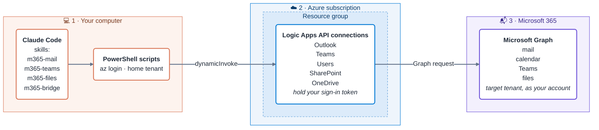

# M365 Connector Bridge for Claude Code

Work with your Microsoft 365 **mail, calendar, Teams chats, people and files** from Claude Code, for an account where the claude.ai Microsoft 365 connector is not available - for example, when the tenant gives no admin consent for mail and chat apps, blocks device-code sign-in, or does not allow the connector app.

It needs no app registration and no admin consent in that tenant. Instead it uses Azure **API connections** (the managed connectors of Logic Apps) that you authorize once with your own account.

## How it works



1. **Your computer:** you ask Claude Code; a skill runs a small PowerShell script, signed in to Azure with `az login`.
2. **Azure subscription:** the script calls an API connection through Azure Resource Manager (`dynamicInvoke`). Azure roles decide who may do that.
3. **Microsoft 365:** the connection calls Microsoft Graph with the token you stored when you authorized it, so Graph sees your account.

Technical details: [docs/how-it-works.md](docs/how-it-works.md).

## What you can ask

- "Check my mail from today. Anything I haven't answered?"
- "Find the thread with Pat about the invoice and summarize it."
- "Draft a reply-all: we agree, start on Monday." (stays a draft until you say "send")
- "What did Sam write me in Teams? Open the screenshot he pasted."
- "What is in my calendar next week?"
- "Find the onboarding checklist on SharePoint and tell me what changed this month." (only files your account can open)

## Install and set up

```text
claude plugin install m365-bridge --marketplace valerymoskalenko/M365-Connector-Bridge-for-Claude-Code
```

Then ask Claude **"set up the M365 bridge"**. Setup takes about 15 minutes, once: [docs/setup.md](docs/setup.md).

| Skill | For |
|---|---|
| `m365-bridge` | setup, how it works, errors, safety rules |
| `m365-mail` | inbox, search, threads, Sent Items, attachments, calendar, drafts |
| `m365-teams` | chats, a chat with a person, pasted images, watching a chat, meeting check |
| `m365-files` | SharePoint and OneDrive: search, site libraries, folders, a file or sharing link as text, download (read-only) |

## Safe by default

- **Read-only.** Nothing is changed without your OK for that exact action.
- **Drafts, not sends.** "Write an email" or "answer him in Teams" gives you the text or a draft first; it is sent or posted only when you say "send".
- **Who else can use your connections?** Everyone with Owner, Contributor or Logic App Contributor on them, also inherited from the subscription or management groups. Knowing the URL alone gives no access. Check and reduce it: [docs/security.md](docs/security.md).

Use the bridge only with your own account, and check your organization's policies first.

## Documentation

| Document | What is in it |
|---|---|
| [docs/setup.md](docs/setup.md) | install, config file, create and authorize the connections, test, move |
| [docs/how-it-works.md](docs/how-it-works.md) | `dynamicInvoke`, connector operations, request and response format |
| [docs/scripts.md](docs/scripts.md) | `Invoke-M365Graph.ps1`, `Invoke-M365SharePoint.ps1` and the helper scripts (drafts, signature, chat watcher, file search and reading) |
| [docs/security.md](docs/security.md) | which Azure roles give access, how to check, reduce and detect it, emergency stop |
| [docs/findings.md](docs/findings.md) | what was tested, path rules and limits of each connector |
| [docs/m365-connector-comparison.md](docs/m365-connector-comparison.md) | the claude.ai Microsoft 365 connector compared with this bridge |
| [docs/connector-operations.md](docs/connector-operations.md) | useful operations of each connector (Outlook, Teams, Users, SharePoint, OneDrive) |
| [docs/mcp-server-plan.md](docs/mcp-server-plan.md) | an idea: a local MCP server with the connector's tool names (not decided) |

## Terms

- **Target account / target tenant** - the Microsoft 365 account and tenant you want to work with, where the claude.ai connector is not available.
- **Home tenant** - the tenant of the Azure subscription that holds the connections. `az login` uses an account of this tenant. It can be the **same tenant as the target tenant**, or a **separate tenant**, for example a personal one. A separate tenant where you are the only admin is also the safest choice: see [docs/security.md](docs/security.md).

## License

MIT - see [LICENSE](LICENSE).
