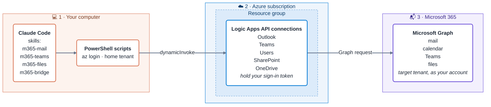

# How it works

The picture is from the [README](../README.md#how-it-works). This page has the technical details.



1. **Your computer:** you ask Claude Code; a skill runs a small PowerShell script, signed in to Azure with `az login`.
2. **Azure subscription:** the script calls an API connection through Azure Resource Manager (`dynamicInvoke`). Azure roles decide who may do that.
3. **Microsoft 365:** the connection calls Microsoft Graph with the token you stored when you authorized it, so Graph sees your account.

```text
local az login (home tenant account)
  -> POST https://management.azure.com/<connection id>/dynamicInvoke?api-version=2016-06-01
       body: { "request": { "method": "POST", "path": "<connector operation path>", "headers": {...}, "body": ... } }
     -> the connector runs the operation with the token stored in the connection
        -> Microsoft Graph / SharePoint as the target account
```

- A **connection** (`Microsoft.Web/connections`, the same resource Logic Apps use) is a standalone Azure resource that stores the target account's OAuth access and refresh tokens. No Logic App is needed.
- `dynamicInvoke` is the action the Azure portal uses to fill dropdowns in the Logic Apps designer. It is **not documented for production use** and may change.
- Azure checks the caller's Azure role before the connector runs: see [security.md](security.md).
- Generic operations ("Send an HTTP request"):

  | Connector | Operation path | Calls |
  |---|---|---|
  | Office 365 Outlook | `/codeless/httprequest` | Microsoft Graph |
  | Microsoft Teams | `/httprequest` | Microsoft Graph |
  | Office 365 Users | `/codeless/httprequest` | Microsoft Graph, almost any `me/...` or `users/...` path |
  | SharePoint | `/datasets/{site URL, encoded twice}/httprequest` | SharePoint REST |

  Each connector allows only some Graph paths: [findings.md](findings.md).
- SharePoint REST also serves the OneDrive API under `_api/v2.0/` (`shares`, `drives`, `items`), so one connection reaches every site and every OneDrive the account can open. File content is not sent through the connector: the script reads the item's short-lived `@content.downloadUrl` and downloads the file straight from SharePoint (no connector size limit).
- Response: `{ "response": { "statusCode": "OK", "headers": {...}, "body": ... } }`. Binary content comes as `{ "$content-type": "...", "$content": "<base64>" }`.
- Each call takes about 0.5-2 seconds. Connector throttling applies (Outlook about 300 calls per 60 seconds per connection).
